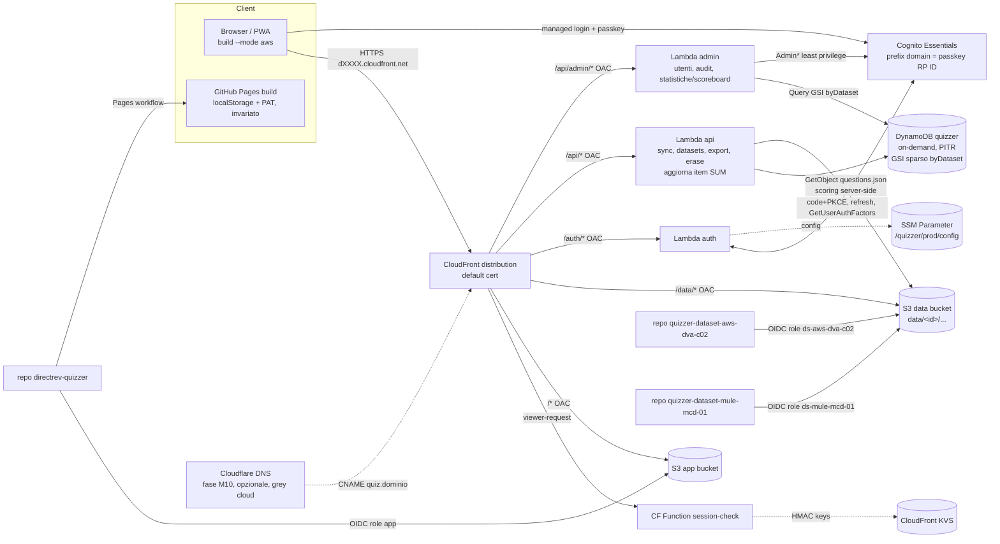

# Quizzer su AWS: piano v2 (Terraform, passkey, progressi su DynamoDB, admin con statistiche)

> Solo pianificazione: nessun repo modificato, nessuna API cloud chiamata, nessuna risorsa creata.
> Basato su `directrev-quizzer` (branch `feat/dataset-sources`, più `origin/fix/ui-overflow`), su `/home/user/quizzer-dataset-aws-dva-c02` e `/home/user/quizzer-dataset-mule-mcd-01`, e sul piano v1 (`aws-plan.md`).
> I fatti esterni sono stati verificati il 2026-10-09 sulla documentazione ufficiale (link inline). Quando un punto non è verificato, il testo lo dice.

## 0. Raccomandazione

1. **Fase 1 sul dominio di default `dXXXX.cloudfront.net`**: niente certificato ACM, niente provider Cloudflare, niente record DNS. Il dominio custom su Cloudflare diventa una fase opzionale successiva (M10), con record **DNS-only (nuvola grigia)**.
2. **L'autenticazione resta per sempre sul prefix domain di Cognito** (`<prefix>.auth.eu-central-1.amazoncognito.com`). L'RP ID dei passkey va fissato esplicitamente su quel nome, così un futuro dominio custom dell'*app* non costringe nessuno a registrare di nuovo il passkey.
3. Si conserva l'architettura v1: CloudFront, due bucket S3 privati con OAC, Lambda `auth` che emette un cookie HMAC, CloudFront Function con KVS. Si aggiungono **due Lambda (`api` e `admin`)** dietro Function URL con OAC e **una tabella DynamoDB on-demand** (single-table).
4. IaC con **Terraform** compatibile con OpenTofu: S3 backend con `use_lockfile`, bootstrap del bucket di stato, test offline con `terraform test` e mock provider. Il deploy lo fa l'utente dal suo PC.
5. Login: Cognito Essentials con managed login, **password più passkey**. Default "forte": MFA `ON` (TOTP) con passkey-con-UV che vale come MFA, quindi nell'uso quotidiano basta un tocco con il passkey; password più TOTP fanno da recovery. La Lambda `auth` impone la registrazione del passkey al primo accesso.
6. **Nessun login GitHub**, né per i colleghi (non serve, e potrebbero non avere un account) né sulla build GitHub Pages: da una SPA senza server non si può fare (§3.4). Su Pages resta il PAT fine-grained.
7. **Admin UI in-app** (`/admin`): inviti, gruppi `ds-<id>`, disable/enable, delete, re-invito, sign-out globale, con audit log in DynamoDB e autorizzazione ricontrollata lato server su Cognito.
8. **Sync dei progressi (GO)**: offline-first con outbox locale. Le stats sono G-counter per device più un baseline LWW (gestisce i reset), le note sono LWW per domanda, le sessioni un'unione per id e la bozza un LWW. Le sessioni si salvano in forma compatta (id e risposte, non le domande intere).
9. **Classifiche e statistiche aggregate solo nel pannello admin** (emendamento). Gli utenti vedono soltanto i propri progressi. Per ogni dataset l'admin vede attività, accuratezza, punteggi exam, domande padroneggiate, ultimo accesso (per utente e aggregati) e **tassi d'errore per domanda**, con la distribuzione delle opzioni scelte: aiutano a trovare risposte sbagliate nei dataset. I dati vengono da un item di riepilogo per utente e dataset, aggiornato a ogni sync e letto con un GSI sparso. Niente WebSocket, Streams o AppSync: la pagina si aggiorna all'apertura e con un pulsante "Aggiorna". Utenti e email di invito vengono informati che l'admin vede le loro statistiche.
10. **Due deployment, un solo codebase**: `vite build` (Pages, identico a oggi) e `vite build --mode aws`. La CI di ciascun repo dati pubblica su `s3://…/data/<datasetId>/` con un ruolo OIDC limitato a quel prefisso. Non esiste un `index.json` condiviso: la lista dei dataset la compone `GET /api/datasets` filtrata sui gruppi dell'utente.
11. Costo stimato per circa 20 utenti: **meno di 1 USD/mese**, coperto dai crediti. Va verificato che l'account sia sul **Paid plan**: il Free plan chiude l'account dopo 6 mesi (§7).
12. Primo rilascio piccolo (M1-M5, circa 9-10 giorni di sviluppo): app e dati dietro login con passkey su cloudfront.net, inviti da CLI. Sync, admin e statistiche admin seguono come milestone indipendenti. Totale circa 22-26 giorni di sviluppo.

---

## 1. Architettura (fase 1, senza dominio custom)



Rispetto alla v1 i behavior della distribuzione aumentano. L'ordine conta: `/api/admin/*` va prima di `/api/*`.

| Path | Origin | CF Function | Cache |
|---|---|---|---|
| `/auth/*` | Lambda `auth` (OAC) | nessuna | `CachingDisabled`, `AllViewerExceptHostHeader` |
| `/api/admin/*` | Lambda `admin` (OAC) | `session-check`, che richiede `adm=true` | `CachingDisabled` |
| `/api/*` | Lambda `api` (OAC) | `session-check`, che richiede una sessione valida (401 JSON se manca) | `CachingDisabled` |
| `/data/*` | data bucket (OAC) | `session-check`, che richiede `<id>` in `ds` | edge 1 giorno, browser `private, no-cache` (come v1) |
| default | app bucket (OAC) | `session-check` (302 su navigazione) | `CachingOptimized` (come v1) |

### 1.1 Cosa cambia rispetto al piano v1

| Tema | v1 | v2 | Perché |
|---|---|---|---|
| IaC | CDK TypeScript | **Terraform** (compatibile OpenTofu) | Decisione dell'utente |
| Dominio/DNS | Route53, `quiz.<dominio>` | **`*.cloudfront.net`** in fase 1; Cloudflare DNS-only in M10 opzionale | Decisione dell'utente (DNS su Cloudflare, poi preferenza per cloudfront.net) |
| Dati | 1 repo `quizzer-data` | **2 repo** `quizzer-dataset-<code>`, prefisso e ruolo CI per dataset, nessun `index.json` condiviso | Fatto corretto; evita la concorrenza sulla scrittura |
| Id dataset | `mcd-level-1` | **`mule-mcd-01`** (gruppo `ds-mule-mcd-01`) | Fatto corretto |
| MFA | TOTP opzionale | **Passkey** (UV required) più TOTP come recovery | Decisione dell'utente |
| Admin | script CLI | **UI in-app** e API `admin` con scoreboard e statistiche per domanda (gli script restano per il bootstrap) | Decisioni dell'utente |
| Tempo reale | n/d | Refresh all'apertura e con "Aggiorna"; niente WebSocket, Streams o AppSync | Solo l'admin guarda (§3.7) |
| Progressi | NO-GO, solo locali | **Sync su DynamoDB**; scoreboard e statistiche (anche per domanda) **solo nel pannello admin** | Decisione dell'utente; i tassi d'errore per domanda erano l'argomento GO già nella v1 |
| GitHub Pages | dismissione | **Resta**, versione senza backend invariata | Decisione dell'utente |
| Config della Lambda | context CDK | **SSM Parameter** letto a runtime | Rompe il ciclo Terraform (§4.4) |
| Cookie | `__Host-` su dominio custom | Identici su cloudfront.net (PSL, §2.1) | Verificato |

---

## 2. Dominio: si parte da cloudfront.net (emendamento)

**Default: fase 1 su `dXXXX.cloudfront.net`.** È fattibile e sicuro. L'unico punto da cui non si torna indietro, l'RP ID dei passkey, non dipende dal dominio dell'app (§2.3).

### 2.1 Cookie, SameSite, CSP

- **`cloudfront.net` è nella Public Suffix List**, nella sezione privata ("Amazon CloudFront", verificato su https://publicsuffix.org/list/public_suffix_list.dat). Ne seguono due cose:
  - `dXXXX.cloudfront.net` è un **sito a sé** (eTLD+1). Le altre distribuzioni (`dYYYY.cloudfront.net`, anche di terzi) sono *cross-site*: non possono impostare cookie con `Domain=cloudfront.net` (i browser rifiutano un `Domain` che sia un public suffix: https://developer.mozilla.org/en-US/docs/Web/HTTP/Reference/Headers/Set-Cookie) e non ricevono i nostri cookie `SameSite=Lax`.
  - L'isolamento tra tenant è quindi equivalente a quello di un dominio proprio.
- **`__Host-qz_session`** (`Secure; HttpOnly; Path=/; SameSite=Lax`, senza `Domain`) funziona senza modifiche: è host-only per definizione (stessa fonte MDN). Il refresh token resta in `__Secure-qz_refresh` con `Path=/auth`, `SameSite=Strict`.
- **Il cookie di stato PKCE deve essere `Lax`, non `Strict`.** Il ritorno da `<prefix>.auth.eu-central-1.amazoncognito.com` a `/auth/callback` è una navigazione top-level *cross-site*. Anche `auth.eu-central-1.amazoncognito.com` è nella PSL (verificato), quindi il dominio Cognito è un sito distinto dall'app.
- **CSP**: quella della v1 non cambia (`connect-src 'self'`; il browser non chiama mai Cognito via fetch, fa solo redirect). `form-action 'self'` va bene perché il redirect al login si fa con `location.assign`.

### 2.2 CloudFront senza alias: cosa si perde

- Con il **certificato di default** CloudFront imposta da solo la security policy **TLSv1**, e non la si può cambiare. Le policy `TLSv1.2_2021`/`TLSv1.3_2025` richiedono un certificato custom con SNI (https://docs.aws.amazon.com/AmazonCloudFront/latest/DeveloperGuide/DownloadDistValuesGeneral.html#DownloadDistValues-security-policy). Nella pratica i browser moderni negoziano TLS 1.3 o 1.2, ma uno scanner segnalerà "TLS 1.0 accettato". È un rischio basso e documentato; si chiude in M10.
- Response headers policy (HSTS, CSP), CloudFront Functions, KVS, OAC, error pages e logging funzionano allo stesso modo. HSTS vale solo per l'host `dXXXX.cloudfront.net`.
- Il nome si può ricordare meno facilmente, e un filtro aziendale potrebbe trattare `*.cloudfront.net` con sospetto (da verificare in M5).

### 2.3 Passkey e RP ID (il punto critico)

Fatti verificati (https://docs.aws.amazon.com/cognito/latest/developerguide/amazon-cognito-user-pools-authentication-flow-methods.html#amazon-cognito-user-pools-authentication-flow-methods-passkey e https://docs.aws.amazon.com/cognito-user-identity-pools/latest/APIReference/API_WebAuthnConfigurationType.html):
- Senza un dominio custom Cognito, l'RP ID di default è il **prefix domain**. Con un dominio custom Cognito il default diventa il suo FQDN, e con managed login **deve** essere quello.
- "If you change your RP ID, your users must register again with the new RP ID."
- L'RP ID non può essere un dominio presente nella PSL.

Conseguenze:
- Il passkey si registra e si usa **sulla pagina di managed login**, non sull'app. **Il dominio dell'app non conta**: spostare l'app da cloudfront.net a `quiz.<dominio>` **non** tocca i passkey.
- I passkey si rompono solo se cambia il **dominio di auth**: aggiungere un custom domain Cognito (`auth.<dominio>`), cambiare il prefisso o ricreare il pool.
- **Decisione: auth sempre sul prefix domain.** In Terraform:
  - `web_authn_configuration { relying_party_id = "<prefix>.auth.eu-central-1.amazoncognito.com", user_verification = "required" }`;
  - `prevent_destroy` su pool e dominio;
  - prefisso scelto una volta per tutte (domanda aperta 2).
- Costo della scelta: la pagina di login mostra `amazoncognito.com`, che è meno "brandizzata". L'alternativa sarebbe un custom domain Cognito dal primo giorno, ma richiede subito un dominio e un certificato in us-east-1, cosa che contraddice la fase 1. Passare più avanti ad `auth.<dominio>` costa **una nuova registrazione del passkey per ogni utente** (circa 1 minuto a testa, guidato dalla Lambda `auth` che rimanda a `/passkeys/add`), più eventuali reset TOTP. Con 20 persone è accettabile, ma non è gratis: non conviene farlo senza un motivo.

### 2.4 Inviti, bookmark, PWA e localStorage se l'URL cambia (M10)

- Il localStorage è **per origine**. Su un nuovo dominio il client parte vuoto. Con la sync attiva (M6) basta un login e il pull ricostruisce tutto. **Si perde solo l'outbox non ancora sincronizzato**, per questo:
  1. aggiungendo l'alias, **anche** `dXXXX.cloudfront.net` resta servito (la distribuzione è la stessa);
  2. sull'origine vecchia un banner "L'app si è spostata" forza un `flush()` dell'outbox e poi apre il nuovo URL; solo dopo N settimane la CF Function fa 301 sulle navigazioni dall'host vecchio;
  3. le callback URL Cognito contengono **entrambi** gli host durante la transizione.
- **Senza sync (se M10 arrivasse prima di M6)** si usa l'export/import JSON esistente (`BackupRestoreModal`): è un passo manuale per ogni utente.
- La **PWA** installata resta legata all'origine vecchia (manifest `scope`/`start_url` e service worker sono per origine), quindi va reinstallata. Le note di rilascio e il banner lo dicono.
- I **cookie** `__Host-` sono host-only: sul nuovo host serve un nuovo login, ma con lo stesso passkey (l'RP ID non cambia).
- **Email di invito**: il template Cognito prende l'URL da una variabile Terraform (`app_url`); dopo M10 si aggiorna e si fa un re-invite solo per chi non è ancora entrato.

### 2.5 Costi e complessità a confronto con il dominio custom

| | cloudfront.net (fase 1) | Dominio custom (M10) |
|---|---|---|
| Risorse in più | nessuna | ACM in us-east-1, validazione e CNAME su Cloudflare, alias, provider `cloudflare` e token API |
| Costo | 0 | dominio (registrar, circa 10-15 USD/anno se nuovo); ACM e Cloudflare DNS gratis |
| TLS minimo | TLSv1 (fisso) | `TLSv1.2_2021` o `TLSv1.3_2025` |
| Passkey | invariati | invariati (auth resta sul prefix) |
| Effort | 0 | circa 1 giorno (codice e runbook) più propagazione DNS |

**Passi di M10:**
1. root `live/domain`: certificato ACM in us-east-1, record di validazione `cloudflare_dns_record` (`proxied=false`), `aws_acm_certificate_validation`, CNAME `quiz` verso l'output `distribution_domain_name`;
2. root `live/app`: `var.custom_domain` e `var.acm_certificate_arn` attivano `aliases` e `viewer_certificate { ssl_support_method = "sni-only", minimum_protocol_version = "TLSv1.2_2021" }`;
3. Cognito: si aggiungono le callback e logout URL del nuovo host (SSM e client);
4. variabile `app_url` per i template email;
5. la CSP non cambia (`'self'`);
6. i cookie non cambiano (host-only);
7. i passkey non cambiano.

### 2.6 Cloudflare: DNS-only o proxied (vale per M10)

**Default: DNS-only (nuvola grigia).** Con il proxy arancione Cloudflare termina TLS e si mette davanti a CloudFront, cioè due CDN in serie (https://developers.cloudflare.com/dns/proxy-status/). Cosa comporta:
- **Caching**: Cloudflare mette in cache per estensione (immagini, JS, CSS) ma non JSON o HTML, e rispetta `private`/`no-store`/`Set-Cookie` (https://developers.cloudflare.com/cache/concepts/default-cache-behavior/). Oggi è quindi "sicuro" solo perché `/data/*` risponde `private`. Basterebbe una Cache Rule con Edge TTL o un cambio di header per servire **immagini MCD a utenti non autenticati**: è il rischio principale.
- **Cookie e CSP**: Cloudflare aggiunge i propri cookie (bot management) e funzioni come Rocket Loader o la email obfuscation, che iniettano script e rompono `script-src 'self'`.
- **Doppio TLS e certificati**: servono anche le modalità SSL "Full (strict)" e un header Host coerente con l'alias.

Non si guadagna nulla di misurabile: CloudFront fa già da CDN e da edge auth.

---

## 3. Decisioni sui punti ambigui

### 3.1 Terraform e OpenTofu
- **Default: Terraform ≥ 1.11** (la release corrente da checkpoint è 1.16.5), codice **compatibile con OpenTofu ≥ 1.10**: `required_version = ">= 1.10"`. OpenTofu confronta `required_version` con la propria versione, quindi un vincolo troppo alto la escluderebbe.
- Il backend S3 con `use_lockfile` è supportato da entrambi:
  - Terraform depreca il lock su DynamoDB (https://developer.hashicorp.com/terraform/language/backend/s3);
  - OpenTofu supporta entrambi e indica il lockfile S3 come preferito (https://opentofu.org/docs/language/settings/backends/s3/).
- Per restare compatibili gratis:
  - nessuna feature esclusiva (né la state encryption di tofu né quelle solo HCP/Terraform Cloud);
  - provider `hashicorp/aws` e `cloudflare/cloudflare`, che si risolvono su entrambi i registry (verificato: `registry.terraform.io` e `registry.opentofu.org` rispondono 200);
  - un job CI con matrice `terraform`/`tofu` per `validate` e `test`;
  - un `.terraform.lock.hcl` per strumento (tofu può riscriverne gli hash).
- Alternativa: solo OpenTofu (licenza MPL). Non serve: il codice resta neutro.

### 3.2 Stato
- **Default: S3 backend, `use_lockfile = true`, bucket `quizzer-tfstate-<account>-<region>`** con versioning, SSE-S3, Block Public Access e `prevent_destroy`. È adatto a un operatore solo: costo circa 0 e nessuna tabella DynamoDB (deprecata in Terraform).
- **Bootstrap**: la root `infra/bootstrap` crea il bucket con stato locale; poi `terraform init -migrate-state` sposta il suo stato nel bucket stesso (`key = bootstrap/terraform.tfstate`).
- Alternativa: stato solo locale. È più semplice ma fragile: lo stato sta su un solo PC, contiene ARN e id, e se si perde bisogna fare import di tutto. Da scartare.
- Lo stato **non contiene segreti**: la chiave HMAC viene generata fuori da Terraform (script `rotate-session-key`) e scritta nella KVS. I `cloudflarekeyvaluestore_key` gestiti da Terraform si usano solo per valori non segreti.

### 3.3 Test senza credenziali e verifica del sandbox
- Pipeline offline:
  - `terraform fmt -check`, `terraform init -backend=false`, `terraform validate`;
  - `tflint` con il ruleset aws;
  - `trivy config` / `checkov` (bucket pubblici, logging, IAM `*`);
  - **`terraform test` con `mock_provider "aws"`** e `override_resource` (Terraform ≥ 1.7, "without requiring credentials": https://developer.hashicorp.com/terraform/language/tests/mocking), con asserzioni su behavior, OAC, trust policy OIDC (`sub` esatto per repo) e IAM limitata ai prefissi.
  - Limiti: i mock generano stringhe casuali per gli attributi computed e non validano gli ARN. Nella root vanno evitati i data source che richiedono un account (`aws_caller_identity`): l'account id entra come variabile.
- LocalStack: **non raccomandato**. I servizi critici qui (CloudFront Functions/KVS, managed login Cognito, passkey) non si emulano in modo utile; il test d'integrazione vero è M5 sul cloud.
- **Sandbox, verifica fatta con `curl -I` via proxy**:
  - `releases.hashicorp.com/terraform/1.13.3/...zip` → 200;
  - `checkpoint-api.hashicorp.com` → 200 (corrente 1.16.5);
  - `registry.terraform.io` → 200 (aws 6.68.0, cloudflare 5.27.0);
  - `registry.opentofu.org` → 200;
  - asset `github.com/.../releases/download` (tofu, tflint) → 302 verso `release-assets.githubusercontent.com` → 206;
  - `pypi.org` (checkov) → raggiungibile;
  - `api.github.com/repos/...` fuori dai repo della sessione → 403, quindi niente "latest" via API: le versioni vanno pinnate negli URL.

  Conclusione: **terraform, tofu, tflint e checkov sono scaricabili nel sandbox**; i download completi non sono stati eseguiti. Docker è installato.

### 3.4 Login con GitHub: le due letture
- **(a) GitHub come IdP dell'app AWS.** GitHub espone OAuth2, non OIDC: niente `id_token` né discovery. Cognito non ha una federazione GitHub nativa, quindi servirebbe uno shim OIDC (una Lambda che fa da IdP OIDC verso Cognito: firma degli id_token, JWKS, userinfo), codice delicato per la sicurezza.
  - Con la federazione "you delegate primary and MFA authentication factors to the user's IdP" (doc dei flow Cognito citata sopra): **niente passkey Cognito per quegli utenti**, la MFA dipende da GitHub.
  - L'invito resta imponibile solo con la regola "nessun gruppo `ds-*`, nessuna sessione" più un trigger pre-sign-up con allowlist.
  - Gli OIDC MAU gratuiti sono 50, poi 0,015 USD (https://aws.amazon.com/cognito/pricing/).
  - I colleghi potrebbero non avere un account GitHub e non devono vedere i repo.
  - **Verdetto: no.** Al massimo, in futuro, un secondo IdP *solo per l'owner* (la Lambda `auth` è già un server, quindi tecnicamente si può fare).
- **(b) Login GitHub sulla build Pages, al posto del PAT.** Dati verificati:
  - PKCE è supportato dal 2025-07-14 (https://github.blog/changelog/2025-07-14-pkce-support-for-oauth-and-github-app-authentication/), ma lo staff GitHub conferma che allo scambio del token serve ancora il client secret e che l'endpoint token non supporta CORS (https://github.com/orgs/community/discussions/15752).
  - Nostro test via proxy: `login/oauth/access_token`, `login/device/code` e `login/oauth/authorize` non restituiscono header `Access-Control-*`; il preflight `OPTIONS` riceve 405.
  - Il device flow è pensato per app headless.

  **Dalla sola SPA quindi non si può.** Servirebbe un proxy di scambio (un Cloudflare Worker o una Lambda nello stack AWS): un componente server con il client secret, che contraddice "Pages senza backend", per un solo utente.
- **Default: nessun login GitHub.** Su Pages resta il PAT fine-grained (read-only, solo i 2 repo dati, scadenza breve). Opzionale e separato: un endpoint `/gh/token` nello stack AWS (circa 0,5 giorni più la registrazione della GitHub App), da fare solo se il PAT diventa scomodo.

### 3.5 MFA con passkey (Cognito)
Fatti verificati:
- Passkey disponibili in tutti i piani tranne Lite, solo con **choice-based sign-in** (`ALLOW_USER_AUTH`). `WEB_AUTHN` richiede un altro first factor. User verification `preferred` o `required`. Massimo 20 passkey per utente. Registrazione possibile solo dopo il primo login (doc dei flow sopra).
- Nel managed login la pagina `…/passkeys/add` registra un passkey e poi reindirizza al `redirect_uri` (https://repost.aws/knowledge-center/cognito-passwordless-authentication).
- Con `FactorConfiguration = MULTI_FACTOR_WITH_USER_VERIFICATION` un passkey con UV **soddisfa da solo la MFA required**. I passkey non possono essere il *secondo* fattore dopo la password. OTP via email e MFA required sono incompatibili (https://docs.aws.amazon.com/cognito/latest/developerguide/user-pool-settings-mfa.html).
- Email OTP (passwordless o MFA) richiede **SES** (https://docs.aws.amazon.com/cognito/latest/developerguide/user-pool-email.html): niente SES in fase 1, quindi niente OTP via email.
- Il provider AWS espone `sign_in_policy`, `web_authn_configuration { relying_party_id, user_verification }` e `user_pool_tier`, ma **non `FactorConfiguration`** (verificato su docs/CHANGELOG del provider, `main`). Si imposta con un `terraform_data` che lancia `aws cognito-idp set-user-pool-mfa-config` (idempotente, trigger sull'hash della config), più `ignore_changes` sui campi MFA del pool. Ad ogni major del provider si ricontrolla se l'argomento è arrivato.

Opzioni:
- **Default (A) "passkey come MFA":**
  - configurazione: `mfa_configuration = ON` (TOTP), `allowed_first_auth_factors = ["PASSWORD","WEB_AUTHN"]`, UV `required`, `FactorConfiguration = MULTI_FACTOR_WITH_USER_VERIFICATION`;
  - onboarding: email di invito con password temporanea, poi password nuova, poi setup TOTP (forzato da Cognito), poi la Lambda `auth` controlla `GetUserAuthFactors` (access token con scope `aws.cognito.signin.user.admin`, https://docs.aws.amazon.com/cognito-user-identity-pools/latest/APIReference/API_GetUserAuthFactors.html) e, se manca `WEB_AUTHN`, rimanda a `/passkeys/add` prima di emettere la sessione;
  - uso quotidiano: un solo passkey;
  - recovery: password più TOTP; se si perde tutto, l'admin fa `AdminResetUserPassword` più un reset dell'MFA.
  - Ogni login è a due fattori. Va bene per il dataset MCD.
- **Alternativa (B) "leggera":** MFA `OFF`, `["PASSWORD","WEB_AUTHN"]`, e l'enrollment del passkey imposto dalla Lambda. Senza TOTP l'onboarding è più semplice, ma la password da sola resta un percorso di login a un fattore.
- **(C) passwordless puro** (`WEB_AUTHN` più `EMAIL_OTP`): richiede SES fuori dal sandbox e non è compatibile con la MFA required. Rimandato.

### 3.6 Admin
Il design è nel §5.3. **Default: Lambda dedicata dietro Function URL con OAC**, non API Gateway: costo 0, stessa origine, nessuna CORS. Throttling con reserved concurrency (2) e token bucket in DynamoDB.
Alternativa: API Gateway HTTP API (1 USD/M, throttling nativo per route; https://aws.amazon.com/api-gateway/pricing/). Ha senso solo se servono gli usage plan.
Vincolo da ricordare: con OAC, POST e PUT devono inviare `x-amz-content-sha256` del body (https://docs.aws.amazon.com/AmazonCloudFront/latest/DeveloperGuide/private-content-restricting-access-to-lambda.html). Il client lo calcola con `crypto.subtle`. La permission Lambda serve **sia** per `lambda:InvokeFunctionUrl` **sia** per `lambda:InvokeFunction` (stessa doc).

### 3.7 Scoreboard "live" (solo admin)
Lo guarda una sola persona, quindi **default: caricamento all'apertura della pagina, pulsante "Aggiorna" e, opzionalmente, un auto-refresh ogni 60 s mentre la tab è visibile** (`GET` con ETag/304). Le alternative si scartano esplicitamente:
- **API Gateway WebSocket più DynamoDB Streams**: tabella delle connessioni, auth sul `$connect`, behavior o dominio in più, Lambda di fan-out. Costerebbe pochi centesimi (1 USD/M messaggi, 0,25 USD/M minuti di connessione: https://aws.amazon.com/api-gateway/pricing/), ma richiede circa 2-3 giorni di lavoro e altri componenti da mantenere.
- **AppSync Events** e **SSE con Lambda response streaming**: un servizio o un modello di auth nuovo, per lo stesso beneficio nullo.

Si risparmiano circa 2-3 giorni e circa 6 risorse Terraform. Un aggiornamento al minuto è sufficiente per un admin.

### 3.8 Due deployment, un solo codebase
- **Default: modalità di build.** `vite build` produce Pages, identica a oggi. `vite build --mode aws` (`.env.aws`: `VITE_DEPLOY=aws`) include `src/aws/*` (auth, sync, admin) tramite `import.meta.env.VITE_DEPLOY === 'aws'`, così il codice non usato sparisce dalla build Pages.
- Alternativa: feature detection a runtime (`GET /api/me`). Si scarta: su Pages darebbe 404 ed errori in console, e tutto il codice finirebbe in entrambe le build.
- Nella build AWS le sorgenti `github`/`url` restano disponibili sotto "Avanzate" (decisione invariata dalla v1). Il dataset incluso nel bundle è **nascosto di default**, per evitare un doppione di `aws-dva-c02` con progressi separati.
- Pipeline dati: §5.5.

---

## 4. Terraform

### 4.1 Layout
```text
infra/
  bootstrap/                 # bucket di stato (stato locale, poi migrate-state)
  modules/
    edge/                    # CF Function + KVS + response headers policy + cache policies
    site/                    # bucket app/data/log, OAC, distribuzione, behavior
    identity/                # user pool, prefix domain, client, gruppi ds-* e admin, branding, terraform_data mfa
    lambdas/                 # auth/api/admin: function, function URL (AWS_IAM), permission CF, log group
    data/                    # DynamoDB quizzer (PITR, TTL, prevent_destroy)
    ci/                      # GitHub OIDC provider (opzionale/import), ruoli app e per-dataset
  live/
    app/                     # root principale (aws, eu-central-1)
      versions.tf backend.tf main.tf variables.tf outputs.tf
      tests/*.tftest.hcl     # mock_provider "aws"
    domain/                  # M10: providers aws.use1 + cloudflare (ACM, validazione, CNAME)
  scripts/ invite-user.sh  rotate-session-key.sh  set-mfa-config.sh  check-plan.sh
  lambda/ auth/ api/ admin/  # TypeScript, bundle esbuild -> dist/*.zip (archive_file)
  edge/ session-core.js session-check.js
```
Un solo ambiente `prod` in fase 1. `dev` si ottiene con un secondo workspace o una seconda chiave di stato e un prefisso nei nomi: con 0 USD di costo è consigliato ma non bloccante.

### 4.2 Provider, versioni, backend
```hcl
terraform {
  required_version = ">= 1.10"
  required_providers {
    aws     = { source = "hashicorp/aws", version = "~> 6.60" }
    archive = { source = "hashicorp/archive", version = "~> 2.7" }
    # solo in live/domain:
    # cloudflare = { source = "cloudflare/cloudflare", version = "~> 5.20" }
  }
  backend "s3" {
    bucket = "quizzer-tfstate-<account>-eu-central-1"
    key    = "app/terraform.tfstate"
    region = "eu-central-1"
    use_lockfile = true
    encrypt      = true
  }
}
provider "aws" { region = var.region  default_tags { tags = { app = "quizzer" } } }
```
Il provider `cloudflare` (token con permessi DNS Write limitati alla zona) vive **solo** in `live/domain`, così la fase 1 non richiede nessun token Cloudflare.

### 4.3 Variabili e output principali
- **Variabili:**
  - `account_id`, `region` (default `eu-central-1`);
  - `cognito_domain_prefix` (permanente);
  - `admin_email`;
  - `app_repo = "RedLicorice/directrev-quizzer"`;
  - `datasets = { "aws-dva-c02" = { repo = "RedLicorice/quizzer-dataset-aws-dva-c02" }, "mule-mcd-01" = { repo = "RedLicorice/quizzer-dataset-mule-mcd-01" } }`, da cui `for_each` genera i gruppi `ds-<id>`, i ruoli CI e i permessi sui prefissi;
  - `mfa_mode = "passkey_mfa" | "light"`;
  - `custom_domain = null`, `acm_certificate_arn = null`;
  - `create_github_oidc_provider = true`;
  - `log_retention_days = 90`, `budget_email`.
- **Output:**
  - `distribution_domain_name`, `distribution_id`;
  - `app_bucket`, `data_bucket`;
  - `user_pool_id`, `cognito_domain`;
  - `role_arn_app`, `role_arn_dataset[<id>]`;
  - `kvs_arn`, `table_name`.

  La CI legge gli output come GitHub Variables (non segreti).

### 4.4 Ciclo di dipendenze e stabilità
**Il ciclo**: le callback del client Cognito richiedono il dominio della distribuzione; la distribuzione ha come origin la Function URL della Lambda `auth`; la Lambda avrebbe bisogno del client id.
**Come si rompe**: la Lambda **non** riceve né client id né URL dell'app come env var. Il grafo diventa:
- `aws_cloudfront_distribution` → function URL → function (che non dipende da Cognito);
- `aws_cognito_user_pool_client.callback_urls = ["https://${distribution.domain_name}/auth/callback"]`;
- `aws_ssm_parameter "/quizzer/prod/config"` (JSON `{userPoolId, clientId, cognitoDomain, appOrigin, rpId}`) → dipende da client e distribuzione;
- la Lambda lo legge al cold start con cache di 5 minuti. La sua policy IAM costruisce l'ARN del parametro dal nome, quindi senza dipendenza nel grafo;
- `aws_lambda_permission` (le due action), che dipende dall'ARN della distribuzione.

Risultato: **un solo `apply`, idempotente**. `redirect_uri` **non** si calcola dall'header Host: con OAC l'Host che arriva all'origin è quello della Function URL, e comunque fidarsi dell'Host è un vettore di open redirect. Le Lambda `api` e `admin` ricevono `USER_POOL_ID` e `TABLE_NAME` come env, cosa che non crea cicli. Costo SSM: parametro standard gratuito.

**Stabilità del dominio** (finisce in Cognito, nelle email e nei bookmark):
- `lifecycle { prevent_destroy = true }` su distribuzione, user pool, domain, tabella, data bucket e state bucket;
- niente attributi "ForceNew" variabili, nessun nome esplicito per la distribuzione;
- `moved {}` per i refactoring;
- `scripts/check-plan.sh`: `terraform show -json plan | jq` fallisce se una di queste risorse compare con `delete`/`replace`. Il runbook lo esegue sempre prima di `apply`.

### 4.5 Inventario delle risorse (fase 1)
| Area | Risorse |
|---|---|
| Stato | `aws_s3_bucket` (+versioning, SSE, PAB, policy TLS-only) in `bootstrap` |
| Storage | bucket `app`, `data` (versioning, lifecycle 90 gg sulle versioni non correnti), `logs`; `aws_s3_bucket_policy` OAC (`AWS:SourceArn` = distribuzione) |
| Edge | `aws_cloudfront_distribution` (5 behavior), `aws_cloudfront_origin_access_control` ×2 (s3, lambda), `aws_cloudfront_function` (`session-check`, runtime `cloudfront-js-2.0`, associazione KVS), `aws_cloudfront_key_value_store`, `aws_cloudfront_response_headers_policy`, cache e origin-request policy |
| Identity | `aws_cognito_user_pool` (tier `ESSENTIALS`, `admin_create_user_config.allow_admin_create_user_only = true`, `sign_in_policy`, `web_authn_configuration`, template di invito con `app_url`), `aws_cognito_user_pool_domain` (prefix, `managed_login_version = 2`), `aws_cognito_managed_login_branding`, `aws_cognito_user_pool_client` (public, code+PKCE, `ALLOW_USER_AUTH`, `ALLOW_REFRESH_TOKEN_AUTH`, scope `openid email profile aws.cognito.signin.user.admin`, token revocation), `aws_cognito_user_group` (`admin`, `ds-<id>`, `ds-all`), `terraform_data.mfa_config` |
| Compute | 3× `aws_lambda_function` (nodejs22.x, arm64), 3× `aws_lambda_function_url` (`AWS_IAM`), 6× `aws_lambda_permission`, 3× `aws_cloudwatch_log_group` (90 gg), reserved concurrency (auth 10, api 10, admin 2), ruoli IAM dedicati |
| Dati | `aws_dynamodb_table.quizzer` (PAY_PER_REQUEST, PITR, TTL `expiresAt`, SSE di default, GSI sparso `byDataset` su `gsi1pk`/`gsi1sk`), `aws_ssm_parameter` config |
| CI | `aws_iam_openid_connect_provider` GitHub (o import), ruolo `quizzer-app-publisher`, `for_each` ruoli `quizzer-ds-<id>-publisher` |
| Osservabilità | `aws_budgets_budget` (5 USD), allarmi CloudWatch (5xx e throttles delle Lambda, errori della CF Function), CloudTrail di default |

### 4.6 Chi fa cosa
| Terraform | Codice app (repo) | CI (GitHub Actions) | Utente, a mano |
|---|---|---|---|
| tutte le risorse sopra, policy, gruppi, template email | SPA, Lambda (TS), CF Function, mock backend, test | build e sync app, publish dataset, invalidazioni, `terraform validate/test` (senza credenziali) | `bootstrap` e `apply` dal PC, chiave HMAC iniziale (`rotate-session-key.sh`), primo admin (`invite-user.sh`), passaggio al Paid plan, M10 Cloudflare |

---

## 5. Modifiche all'app e backend

### 5.1 Modulo per modulo
**Prerequisito**: fare il merge (o il rebase) di `fix/ui-overflow` **prima** di M2. Tocca `HomeScreen`, `DatasetScreen`, `DatasetPickerModal`, le sessioni e `index.css`, cioè gli stessi file di questo piano. Le nuove schermate usano le utility aggiunte in `index.css` da quel branch e i pattern esistenti: card `bg-slate-800`, header con icone `lucide-react`.

| # | File | Modifica |
|---|---|---|
| 1 | `src/types.ts` | `SourceConfig.kind` aggiunge `'hosted'`. `Session { sub, email, name?, ds[], adm, exp }`. `SessionRecord.id` diventa `<deviceId>-<ts>` (unicità tra device). Nuovo `CompactSessionRecord` (`questionIds`, `answers`, `config`, `timeElapsed`, `correctCount`, `mode`, `date`). |
| 2 | `src/utils/datasets.ts` | Kind `hosted`: `loadIndex` → `GET /api/datasets`; `rawUrl` → `${BASE_URL}data/${path}`; `` diretto senza blob; 401 lancia `AuthRequiredError`, 403 "non abilitato". `datasetKey()` in modalità aws: `u:<sub>:hosted:<datasetId>`. `clearPrivateCaches()`. |
| 3 | `src/utils/storage.ts` | Prefisso utente (`setStorageUser(sub)`): le chiavi diventano `quizzer_stats:u:<sub>:hosted:<ds>` ecc. Ogni scrittura passa da `progressStore` (punto 5), così la sync intercetta le modifiche. Il codice in `App.tsx`, `PracticeSession.tsx`, `SessionHistoryScreen.tsx` e `BackupRestoreModal.tsx` che usa `localStorage` direttamente va spostato su questo modulo (oggi ci sono 15 accessi diretti). |
| 4 | **nuovo** `src/aws/auth/{session.ts,AuthGate.tsx,useSession.ts}` | Come la v1: `/auth/me`, refresh pianificato, stati `loading/authenticated/offline/redirecting`. In più lo stato `passkey-required`, gestito lato server con un redirect. |
| 5 | **nuovo** `src/aws/sync/{progressStore.ts,outbox.ts,merge.ts,syncClient.ts}` | Store locale con merge CRDT (§5.2), outbox persistente, trigger di sync (login, fine sessione, `online`, `visibilitychange`, ogni 5 min a schermo visibile), `deviceId` in localStorage. Badge "sincronizzato / in attesa / offline". |
| 6 | **nuovo** `src/aws/api.ts` | `apiFetch()`: `credentials:'same-origin'`, header `x-qz-csrf: 1`, `x-amz-content-sha256` calcolato con `crypto.subtle.digest('SHA-256', body)`, retry singolo dopo refresh su 401. |
| 7 | **nuovo** `src/aws/admin/{AdminScreen.tsx,UserList.tsx,UserDetail.tsx,InviteModal.tsx,AuditLog.tsx,DatasetStats.tsx,QuestionStats.tsx}` | Schermate del §5.3 e §5.4. Visibili solo con `session.adm`. |
| 8 | (nessuna classifica per gli utenti in questa fase) | Vedi §5.4, "porta aperta". |
| 9 | **nuovo** `src/aws/privacy/MyDataScreen.tsx` | Export JSON di tutti i miei dati, "cancella i miei progressi", **informativa di trasparenza**: "l'amministratore vede le tue statistiche di studio (attività, punteggi, accuratezza), non le tue note". La stessa frase compare una volta al primo login. |
| 10 | `src/App.tsx`, `HomeScreen.tsx` | Le nuove `Screen`: `admin`, `mydata`. Chip utente, Esci, stato sync. I pulsanti compaiono solo in modalità aws. |
| 11 | `DatasetScreen.tsx`, `DatasetPickerModal.tsx` | Sorgente `hosted` in sola lettura e filtrata su `session.ds`. Sorgenti token sotto "Avanzate". |
| 12 | `BackupRestoreModal.tsx` | Import di un backup (anche dalla versione Pages) dentro l'account: passa da `progressStore` come device `import-<ts>` e poi si sincronizza. |
| 13 | `vite.config.ts` | `navigateFallbackDenylist: [/^\/auth\//, /^\/api\//, /^\/data\//]`; `runtimeCaching` `NetworkOnly` per `/api/` e `/data/`; `cleanupOutdatedCaches`; manifest `name: 'Quizzer'`. Si applica a entrambe le build ed è innocuo su Pages. |
| 14 | `index.html`, `src/main.tsx`, `package.json` | Font self-hosted (`@fontsource/inter`, `@fontsource/jetbrains-mono`), rimozione di Google Fonts. `main.tsx` avvolge l'app con `AuthGate` solo con `VITE_DEPLOY=aws`. |
| 15 | **nuovo** `.env.aws`, `.github/workflows/deploy-aws.yml` | Build `--mode aws` e sync S3 (come la v1). `deploy.yml` (Pages) **resta invariato**. |
| 16 | **nuovo** `server/` (workspace) | `server/core/*`: logica pura di API, merge, scoring e riepiloghi `SUM`, **condivisa** tra le Lambda e il mock. `server/mock/dev-server.mjs` è il mock backend. |

### 5.2 Sync: modello dati, merge, limiti
**Tabella unica `quizzer`** (PK `pk`, SK `sk`, on-demand). È single-table perché gli accessi sono tutti "per utente e dataset" o "per dataset" e una tabella sola semplifica IAM, backup ed export.

| pk | sk | Contenuto | Merge |
|---|---|---|---|
| `U#<sub>` | `PROFILE` | `createdAt`, `settings`, `transparencyAckAt`, `revokedBefore`, `imports[]` | LWW (`updatedAt`) |
| `U#<sub>` | `D#<ds>#REV` | contatore `rev` (UpdateItem ADD) | monotono |
| `U#<sub>` | `D#<ds>#ST#<deviceId>` | `{qid:[c,w]}` **valori assoluti** di quel device | G-counter: max per campo; il totale è la somma sui device |
| `U#<sub>` | `D#<ds>#STB` | baseline `{qid:[c,w]}` e `resetAt` | LWW per qid; il valore mostrato è totale meno baseline (gestisce "reset stat" e "reset tutto") |
| `U#<sub>` | `D#<ds>#N#<qid>` | `md` (≤ 32 KB), `updatedAt`, `deviceId`, `prev` (la versione persa) | LWW per domanda; il perdente resta in `prev` ("ripristina la versione precedente") |
| `U#<sub>` | `D#<ds>#S#<sessionId>` | sessione compatta (circa 1-3 KB) | unione per id (immutabile) |
| `U#<sub>` | `D#<ds>#DRAFT` | bozza practice (`questionIds`, `answers`, `revealed`, ...) | LWW su `savedAt`; si cancella con un tombstone |
| `U#<sub>` | `D#<ds>#SUM` | riepilogo (§5.4): metriche, `q:{qid:[c,w]}` totali, `opt:{qid:{optKey:n}}`, `lastSeen`; attributi GSI `gsi1pk = DS#<ds>`, `gsi1sk = U#<sub>` | lo scrive solo il server, ricalcolato a ogni sync |
| `AUDIT#<yyyy-mm>` | `<ts>#<ulid>` | `actor`, `action`, `target`, `diff`, `ip`; TTL 400 gg | append-only |
| `RL#<key>` | `<window>` | contatori del rate limit, TTL | ADD condizionale |

Ogni item scritto porta `rev = ++REV`, così il pull è incrementale.

- **Limiti.** Gli item stanno ben sotto i 400 KB: stats con circa 390 domande per device ≈ 8 KB; note per singolo item; sessioni compatte. Le sessioni **non** salvano più le domande intere (oggi `SessionRecord.questions` le contiene): alla lettura si ricostruiscono per id dal dataset. Se un id sparisce, la domanda appare come "rimossa". Si tengono 100 sessioni per dataset come oggi (`MAX_SESSIONS`); la potatura lato server elimina le più vecchie.
- **API** (tutte su `/api`, cookie):
  - `GET /api/me`;
  - `GET /api/datasets`;
  - `POST /api/sync/<ds>` con body `{deviceId, cursor, stats, baseline?, notes[], sessions[], draft?}`, che risponde `{cursor, stats{deviceId:{…}}, baseline, notes[], sessions[], draft}` con gli item `rev > cursor` (con paginazione se supera 1 MB);
  - `PUT /api/profile` (impostazioni, conferma della nota di trasparenza);
  - `GET /api/export`;
  - `DELETE /api/me/progress[?ds=]`.

  Il push è **idempotente** perché le stats sono valori assoluti per device e le sessioni hanno un id. Un retry non conta mai due volte.
- **Offline.** Tutte le letture sono locali. Le scritture vanno in localStorage e nell'outbox (`quizzer_outbox:u:<sub>`). Al ritorno della rete parte un flush. Al login il pull completo avviene prima di mostrare le stats. Se il server non risponde, l'app funziona come oggi.
- **Migrazione al primo login.** Sull'origine AWS **non esistono dati Pages**, perché il localStorage è per origine. Due casi:
  1. dati locali dell'origine AWS senza utente (per esempio l'uso offline prima del primo login, o una build precedente): proposta "Aggiungere questi progressi al tuo account?", che li importa come device `import-<ts>`;
  2. dati della versione Pages: si esportano dal backup JSON esistente e si importano con il punto 12.

  L'import è idempotente (hash del file salvato in `PROFILE.imports[]`).
- **GDPR (essenziale).**
  - Informativa breve in "I miei dati".
  - Export completo in JSON.
  - **Chi vede cosa**: l'utente vede solo i propri dati; l'admin vede le statistiche (item `SUM`), **non** le note né il testo delle sessioni; nessun utente vede dati di altri.
  - **Trasparenza**: una frase nel template dell'email di invito ("l'amministratore può vedere le tue statistiche di studio"), un avviso al primo login (`transparencyAckAt`) e la schermata "I miei dati".
  - Cancellazione: progressi del dataset, oppure tutto, inclusi gli item `SUM` (che spariscono anche dalle statistiche admin).
  - La cancellazione di un utente da parte dell'admin rimuove anche i dati DynamoDB (`Query` più `BatchWrite`).
  - Retention: gli account disabilitati da più di 12 mesi vengono segnalati in admin per la cancellazione; audit 400 giorni; log 90 giorni; PITR 35 giorni (i dati cancellati restano nei backup PITR fino a 35 giorni, da scrivere nell'informativa).
  - Regione UE.

### 5.3 Admin: API e UI
- **API** (Lambda `admin`):

  | Route | Chiamate Cognito |
  |---|---|
  | `GET /api/admin/users?filter=` | `ListUsers` più `ListUsersInGroup` per ogni `ds-*` |
  | `POST /api/admin/users` `{email, groups[]}` | `AdminCreateUser` (`DesiredDeliveryMediums: EMAIL`) più `AdminAddUserToGroup` |
  | `POST /api/admin/users/<u>/resend` | `AdminCreateUser` con `MessageAction: RESEND` |
  | `PUT /api/admin/users/<u>/groups` | diff con `AdminAddUserToGroup` / `AdminRemoveUserFromGroup` |
  | `POST …/disable` e `…/enable` | `AdminDisableUser` / `AdminEnableUser` |
  | `POST …/signout` | `AdminUserGlobalSignOut`, più `revokedBefore` nel `PROFILE`, che le Lambda `api`/`admin` controllano |
  | `POST …/reset` | `AdminResetUserPassword` |
  | `DELETE /api/admin/users/<u>` | `AdminDeleteUser` più purge di DynamoDB |
  | `GET /api/admin/audit?month=` | |
  | `GET /api/admin/overview` | utenti attivi, sync recenti, email del giorno |
  | `GET /api/admin/datasets/<ds>/scoreboard` | (DynamoDB) `Query` GSI `byDataset` più `ListUsersInGroup` per mappare sub ed email (§5.4) |
  | `GET /api/admin/datasets/<ds>/questions` | (DynamoDB) stesso Query, aggregato per domanda, con il testo da `questions.json` |
  | `GET /api/admin/users/<u>/stats` | (DynamoDB) `Query pk=U#<sub>, begins_with(sk,"D#")` limitato agli item `SUM` e `S#` (non `N#`) |

- **Autorizzazione**, a tre livelli:
  1. la CF Function richiede `adm=true` nel cookie firmato;
  2. la Lambda verifica di nuovo l'HMAC del cookie;
  3. la Lambda chiama `AdminListGroupsForUser(sub)` e richiede `admin` in tempo reale (cache 60 s). Una rimozione dal gruppo admin vale quindi subito.

  Inoltre:
  - l'admin non può rimuovere o disabilitare sé stesso (blocco del lockout);
  - le route mutanti richiedono un `Origin` uguale all'host, `x-qz-csrf: 1` e `x-amz-content-sha256`.
- **IAM della Lambda admin** (`Resource` = solo l'ARN del pool): `cognito-idp:ListUsers, ListUsersInGroup, AdminGetUser, AdminListGroupsForUser, AdminCreateUser, AdminAddUserToGroup, AdminRemoveUserFromGroup, AdminDisableUser, AdminEnableUser, AdminUserGlobalSignOut, AdminResetUserPassword, AdminDeleteUser`. Su DynamoDB: `Query` sulla tabella e sull'indice `byDataset`, più `BatchWriteItem/PutItem/DeleteItem` (purge, audit, rate limit). Nessuna `Scan`.
  La Lambda `api` ha soltanto DynamoDB con condizioni sulle chiavi del proprio `sub`: la condizione IAM non conosce il sub, quindi il controllo è applicativo, con test dedicati. Ha anche `s3:GetObject` su `data/*/questions.json` e `data/*/entry.json`, più `s3:ListBucket` sul prefisso `data/`. Nessun permesso Cognito.
- **Rate limit:**
  - admin: 30 mutazioni l'ora e 20 inviti al giorno (sotto il limite email di default di Cognito, 50 al giorno per account: https://docs.aws.amazon.com/cognito/latest/developerguide/quotas.html);
  - api: 120 sync l'ora per utente;
  - reserved concurrency come tetto globale.
- **Audit:** ogni mutazione scrive `AUDIT#` **prima** di rispondere (best-effort: se la scrittura fallisce si restituisce un 500, così non ci sono azioni senza traccia), più un log JSON strutturato su CloudWatch.
- **Schermate**, nello stile esistente (dark slate, card, icone lucide, responsive a 360 px come in `fix/ui-overflow`):
  1. **Utenti**: tabella o lista con email, stato (`FORCE_CHANGE_PASSWORD`, `CONFIRMED`, disabled), badge dei gruppi `ds-*`, passkey sì/no, ultima sync, ricerca;
  2. **Invita**: modale con email e checkbox dei dataset, avviso specifico per `mule-mcd-01`;
  3. **Dettaglio utente**: gruppi (toggle), disable/enable, re-invita, sign-out ovunque, reset password e MFA, elimina (conferma scrivendo l'email), metriche di attività;
  4. **Audit log**: per mese, con filtro per attore e azione;
  5. **Panoramica**: numero di utenti e di sync negli ultimi 7 giorni, email inviate oggi rispetto al limite;
  6. **Scoreboard per dataset** (§5.4): tab dei dataset, tabella ordinabile per utente più riga aggregata, "Aggiorna" e "ultimo aggiornamento";
  7. **Domande del dataset**: ordinate per tasso d'errore, con la distribuzione delle opzioni scelte e un link "apri issue" verso il repo dati;
  8. **Statistiche dell'utente** (nel dettaglio utente): metriche per dataset e sessioni recenti (punteggi, non le note).

### 5.4 Scoreboard e statistiche (solo admin)
- **Metriche per utente e dataset**, scritte nell'item `D#<ds>#SUM` dalla Lambda `api` **nella stessa richiesta di sync** che porta stats o sessioni nuove:
  - `active7` e `active30`: risposte negli ultimi 7 e 30 giorni;
  - `lastSeen`;
  - `accuracy`: risposte corrette su risposte date (exam e practice);
  - `bestExam`, `avgExam5`, `examCount`;
  - `mastered`: domande con `c ≥ 2` e `c/(c+w) ≥ 0,8`;
  - `coverage`: domande viste su totale;
  - `streak`: giorni consecutivi con almeno 10 risposte (fuso Europe/Rome).

  Contiene anche, per domanda, i totali `[c,w]` (stats unite meno il baseline) e `opt`: quante volte è stata scelta ogni opzione. La chiave dell'opzione è l'hash del testo, così l'eventuale shuffle delle opzioni non conta. Le sessioni compatte salvano le risposte come chiavi di opzione.
  Dimensione: circa 390 domande per circa 30 byte, cioè circa 12-20 KB per item, lontano dai 400 KB.
- **Calcolo lato server**: l'esito di ogni risposta si ricalcola su `data/<ds>/questions.json` (lettura S3 con cache) e il `correctCount` del client viene ignorato. Si scartano le sessioni con id sconosciuti o duplicati e le date future. Non è anti-gaming competitivo, visto che non c'è più una classifica pubblica: serve a statistiche corrette.
- **Lettura (admin):**
  - indice `byDataset` sparso (`gsi1pk = DS#<ds>`, `gsi1sk = U#<sub>`, proiezione ALL), presente **solo** sugli item `SUM`;
  - una sola `Query` restituisce tutti gli utenti del dataset: con 50 utenti circa 1 MB, circa 125 RRU eventually consistent, eventualmente su 2 pagine;
  - l'aggregazione per domanda (somma di `q` e `opt` sugli utenti) e le medie si fanno in memoria;
  - `ListUsersInGroup` serve solo per mappare `sub` in email;
  - risposta con ETag.
- **Perché così**, confrontando con le alternative:

  | Opzione | Pro | Contro | Verdetto |
  |---|---|---|---|
  | Calcolo on-demand da tutte le partizioni utente (Query per utente su stats e sessioni) | nessuno stato derivato | N query, circa 10-20 MB letti a 50 utenti, latenza di qualche secondo, cresce con le sessioni | Accettabile ma inutilmente pesante |
  | `Scan` della tabella | semplice | legge note e tutto il resto, cresce con i dati, IAM più larga | No |
  | DynamoDB Streams più Lambda aggregatrice con contatori per dataset e domanda | aggregati pronti | un componente asincrono in più, idempotenza e retry da gestire, dati duplicati | Sovradimensionato a questa scala |
  | **Riepilogo sincrono per utente più GSI sparso** | una scrittura in più per sync, una Query per pagina admin, nessun componente nuovo | il ricalcolo del `SUM` costa circa 20 KB di write (circa 20 WRU) per sync | **Default** |

  Fino a qualche centinaio di utenti va bene senza cambiamenti. Oltre, si passa a Streams senza toccare il formato del client.
- **Domande sospette**, per trovare errori nei dataset: domande con almeno 10 tentativi e tasso d'errore ≥ 60%, oppure con un'opzione "sbagliata" scelta da almeno il 50% delle persone. La schermata 7 le mostra in cima, con la distribuzione delle opzioni e un link a una issue precompilata nel repo `quizzer-dataset-<id>`.
- **Accesso**: solo con il gruppo `admin`, ricontrollato lato server (§5.3). L'admin vede metriche e punteggi, non le note. I gruppi `ds-*` non danno accesso a nessuna statistica di altri.
- **Porta aperta per una classifica utente futura.** Il modello attuale non la blocca, perché gli item `SUM` e il GSI `byDataset` contengono già tutto. Servirebbero:
  1. `displayName` e `lbOptIn` nel `PROFILE` (pseudonimo, mai l'email);
  2. una route `GET /api/leaderboard/<ds>` nella Lambda `api`, che restituisce solo gli opt-in e solo ai membri di `ds-<ds>` (o `ds-all`), proiettando poche metriche;
  3. regole anti-gaming più severe (minimo di secondi per domanda, limite di sessioni al giorno);
  4. una schermata con polling a 30-60 s;
  5. un aggiornamento dell'informativa.

  Stima: circa 2 giorni.

### 5.5 Pipeline dei dati (due repo)
- Workflow `publish.yml` in **ciascun** repo dati (stesso file, parametrizzato):
  1. `validate` (regole della v1 più: `index.json` con **un solo** dataset il cui `id` corrisponde al nome del repo `quizzer-dataset-<id>`);
  2. `aws s3 sync questions.json images/ s3://<data>/data/<id>/ --delete`, con delete limitato al prefisso;
  3. **per ultimo** `data/<id>/entry.json`: l'entry di `index.json` con `file: "<id>/questions.json"`, più `commit` e `publishedAt`;
  4. `create-invalidation /data/<id>/*`;
  5. `concurrency: publish-<id>`.
- **Ruolo OIDC per dataset**:
  - trust `sub = repo:RedLicorice/quizzer-dataset-<id>:environment:prod` (https://docs.github.com/en/actions/security-for-github-actions/security-hardening-your-deployments/configuring-openid-connect-in-amazon-web-services);
  - `s3:PutObject/DeleteObject` solo su `data/<id>/*`, `ListBucket` con `s3:prefix` = `data/<id>/*`, invalidazione sulla sola distribuzione.

  Un repo **non può** toccare l'altro dataset.
- **Nessun index condiviso.** `GET /api/datasets` elenca `data/*/entry.json` (cache di 5 min nella Lambda) e restituisce `{schemaVersion:1, datasets:[…]}` filtrato su `session.ds`. Un collega senza `ds-mule-mcd-01` non vede nemmeno che MCD esiste. Le immagini relative si risolvono su `/data/<id>/images/…` con il `dirOf(file)` già presente.
- Alternativa: un `data/index.json` aggregato da una Lambda su evento S3 oppure con S3 conditional writes (`If-Match`). Si scarta: più componenti, e rivela l'esistenza di tutti i dataset.

### 5.6 Test in locale (senza AWS)
- **`server/mock/dev-server.mjs`** (Node, senza dipendenze cloud), che è anche **implementazione di riferimento del contratto API**:
  - serve `dist/` e i cloni locali `../quizzer-dataset-*` sotto `/data/<id>/`;
  - applica `edge/session-core.js` (stessa verifica della CF Function);
  - `/auth/*` è finto: un form permette di scegliere utente, gruppi, admin e "passkey mancante";
  - `/api/*` e `/api/admin/*` usano `server/core` con uno storage in memoria o su file JSON che rispetta le stesse chiavi pk/sk;
  - Cognito è finto, con utenti in memoria.
- **Test:**
  - `vitest` per il merge CRDT: proprietà commutativa, idempotente, associativa (fast-check), reset tramite baseline, LWW delle note;
  - outbox offline e online;
  - scoring server-side e anti-gaming;
  - autorizzazione admin (claim falso, utente rimosso dal gruppo, self-lockout);
  - CF Function (vettori HMAC, path traversal, `adm`);
  - SW denylist;
  - `datasetKey` per utente;
  - build Pages invariata (snapshot della lista dei chunk senza `src/aws`).
- **Contract test**: la stessa suite gira contro il mock e, in M5+, contro l'ambiente reale (`BASE_URL` più un cookie di test).
- **Infra**: `terraform test` con mock provider, tflint, trivy/checkov (§3.3).

---

## 6. Sicurezza e threat model

- **Token**: nessun token Cognito arriva a JavaScript. La sessione HMAC dura 30 minuti in un cookie HttpOnly; il refresh token sta in `Path=/auth`, `Strict` (come v1). La chiave HMAC è nella KVS e la rotazione funziona da kill switch.
  Il cookie contiene `ds` e `adm`, che vengono ricalcolati al refresh: una modifica dei gruppi diventa effettiva entro 30 minuti per `/data`, e subito per `/api/admin` grazie alla verifica live.
- **CSRF**: si combinano tre difese:
  1. `SameSite=Lax`;
  2. sulle mutazioni, `Origin` uguale all'host e l'header custom `x-qz-csrf`;
  3. `x-amz-content-sha256`, che un form cross-site non può impostare.

  Le GET non cambiano stato.
- **Admin endpoints**: autorizzazione a tre livelli (§5.3), concurrency 2, rate limit, audit. Il comportamento di AWS (OAC) va verificato: `AuthType=AWS_IAM` sulle Function URL e permission legate all'ARN della distribuzione dovrebbero impedire l'invocazione diretta della URL Lambda dall'esterno.
- **Isolamento dei dati per utente** nella Lambda `api`: `sub` arriva **solo** dal cookie verificato, mai dal body o dal path; ci sono test di regressione "IDOR".
- **XSS**: CSP stretta (v1). Le note markdown passano da `react-markdown` senza HTML grezzo.
- **PAT GitHub** (solo build Pages o "Avanzate"): resta in localStorage, read-only e con scadenza.
- **Supply chain/CI**: OIDC senza chiavi statiche, `environment: prod` con approvazione per i repo dati, action pinnate a SHA.
- **Account AWS**: root con MFA, utente admin con SSO o profilo, budget alert, CloudTrail.
- **Dataset MCD**: `mule-mcd-01` deriva da un dump d'esame di terze parti ("certshero dump v13.0"). Questo materiale viola di norma i termini del programma di certificazione e il copyright del venditore, quindi va tenuto ad accesso ristretto: gruppo dedicato con membri minimi, nessuna copia su Pages pubblica, repo privato. Il rischio resta di chi condivide. Va valutato prima di invitare colleghi su quel gruppo.

---

## 7. Costi (circa 20 utenti al mese, eu-central-1)

Ipotesi: 40 sessioni per utente, 5 MB per sessione, 30 sync per utente al giorno (ognuna riscrive anche il `SUM`, circa 20 WRU), pannello admin aperto qualche volta al giorno.

| Voce | Uso stimato | Costo |
|---|---|---|
| CloudFront (traffico, richieste, Functions, KVS) | circa 4 GB, circa 150k richieste, circa 150k invocazioni | 0 (always-free 1 TB e 10M richieste, 2M funzioni; v1) |
| Lambda auth, api, admin | circa 40k invocazioni | 0 (1M richieste e 400k GB-s gratis: https://aws.amazon.com/lambda/pricing/) |
| DynamoDB on-demand (tabella e GSI sparso) | circa 18k sync per circa 25 WRU, più il GSI, cioè circa 0,5-0,9M WRU; circa 50k RRU; meno di 0,2 GB | circa 0,3-0,6 USD (0,625 USD/M WRU, 0,125 USD/M RRU, 25 GB storage gratis; prezzi us-east-1, eu-central-1 poco più alto: https://aws.amazon.com/dynamodb/pricing/on-demand/) |
| DynamoDB PITR | meno di 0,2 GB | circa 0,04 USD |
| API Gateway | non usato (Function URL) | 0 |
| Cognito Essentials | 20 MAU | 0 (10k MAU gratis, senza scadenza: https://aws.amazon.com/cognito/pricing/) |
| SSM Parameter Store (standard) / Secrets Manager | 1 parametro / non usato | 0 |
| S3 (circa 20 MB più versioni, log) | | meno di 0,05 USD |
| CloudWatch Logs (3 Lambda, 90 gg) | pochi MB | meno di 0,10 USD |
| Route53 / ACM / Cloudflare | non usati in fase 1 | 0 |
| WebSocket, Streams, AppSync | non usati (§3.7) | 0 |
| **Totale** | | **meno di 1 USD/mese**, coperto dai crediti. Se il costo dei `SUM` diventasse rilevante, li si riscrive al massimo una volta ogni 5 min per utente e dataset. |

**Attenzione al piano dell'account.** Con il modello attuale il **Free plan** dà fino a 200 USD di crediti ma limita i servizi e **chiude l'account dopo 6 mesi** o quando finiscono i crediti. Il **Paid plan** ha accesso completo e usa comunque i crediti (https://aws.amazon.com/free/). Per un servizio duraturo bisogna essere sul Paid plan, con un budget alert a 5 USD. M0 lo verifica.

---

## 8. Piano a fasi

> Vincolo invariato: l'assistente non ha credenziali cloud. Consegna codice, Terraform, test e runbook; l'utente esegue `apply`, inviti e DNS.

| M | Contenuto | Offline? | Criteri di accettazione | Effort |
|---|---|---|---|---|
| **M0** | Merge di `fix/ui-overflow`, risposte alle domande del §9, account sul Paid plan, budget, MFA del root | utente | Branch base aggiornato, decisioni registrate | 0,5 g |
| **M1** | Repo dati: `validate.mjs` e `publish.yml` (parametrizzato) in **entrambi** i repo; job `validate` sulle PR | Sì | La CI fallisce sugli errori della v1 e su un id dataset diverso dal nome del repo; passa sui dati attuali (o elenca i difetti reali) | 1-1,5 g |
| **M2** | App: build `--mode aws`, kind `hosted`, `AuthGate`, chiavi per utente, fix del SW, font, `apiFetch`, `server/mock` (solo auth, datasets, `/data`), vitest | Sì | `npm test` verde; build Pages identica a oggi (snapshot); con il mock: login finto, MCD visibile solo con il gruppo, 403 altrimenti, `` diretti, logout che svuota le cache | 3 g |
| **M3** | `edge/session-core` e `session-check` (`ds`, `adm`), Lambda `auth` (PKCE, callback, controllo passkey e redirect a `/passkeys/add`, refresh, logout, me, lettura SSM e KVS) | Sì | Test dei casi malevoli; funzione sotto i 10 KB; flusso PKCE e "passkey mancante" testati con un IdP mock | 2,5 g |
| **M4** | Terraform `bootstrap` e `live/app` (fase 1: senza api/admin/DDB opzionali), `terraform_data` MFA, `check-plan.sh`, `terraform test` con mock, tflint, trivy, matrice tofu, runbook | Sì | `validate`/`test` verdi con terraform e tofu; nessun ciclo; i test verificano OAC, PAB, trust OIDC esatti e permessi sui prefissi | 3 g |
| **M5** | **Primo rilascio** (utente): bootstrap, apply, chiave HMAC, invito di sé stesso come admin, publish di entrambi i dataset, test su iOS e Android | No | Login con passkey su `dXXXX.cloudfront.net`; MCD solo con `ds-mule-mcd-01`; utente disabilitato fuori entro 30 min; header di sicurezza presenti; PWA installabile | 1 g utente più supporto |
| **M6** | Sync: tabella, Lambda `api` (sync, export, delete), `progressStore`/outbox/merge, migrazione e import, schermata "I miei dati" | Sì (mock), poi apply | Le property test del merge passano; due browser convergono offline e online; un retry non duplica; il reset si propaga; export ed erase funzionano | 4-5 g |
| **M7** | Admin: Lambda `admin`, IAM, audit, rate limit, schermate 1-5 | Sì (mock), poi apply | Invito, re-invito, gruppi, disable, sign-out ed eliminazione funzionano; un non-admin con claim falsificato riceve 403; self-lockout bloccato; ogni azione è nell'audit | 3 g |
| **M8** | Statistiche admin: scoring server-side, item `SUM` e GSI `byDataset`, route `/api/admin/datasets/*` e `/users/*/stats`, schermate 6-8 con ETag e "Aggiorna", testo di trasparenza (invito e primo login) | Sì (mock), poi apply | Un `correctCount` falsificato non cambia le metriche; un non-admin riceve 403 (anche con claim falsificato); le domande con chiave sbagliata seminate nel mock risultano in cima; le note non compaiono mai nelle risposte admin | 2 g |
| **M9** | Hardening: allarmi, prove dei runbook (offboarding, rotazione HMAC, restore PITR), revisione GDPR, contract test contro prod | No | Runbook eseguiti una volta, allarmi testati | 1 g |
| **M10** (opz.) | Dominio custom: `live/domain` (ACM us-east-1, Cloudflare DNS-only), alias, URL Cognito, banner di migrazione, TLS 1.2+ | Parziale | Nuovo host attivo, vecchio host funzionante durante la transizione, passkey invariati | 1 g più utente |
| **Opz.** | Endpoint di scambio OAuth GitHub per Pages (§3.4) | Parziale | | 0,5-1 g |

**Totale sviluppo**: M1-M4 circa 9,5-10 giorni (primo rilascio con M5); M6-M9 circa 10-11 giorni; M10 circa 1 giorno. **In tutto circa 22-26 giorni**, più circa 3 giorni distribuiti per l'utente.

---

## 9. Domande aperte (con default)

1. **Regione AWS?** *Default:* `eu-central-1` per tutto. La regione `us-east-1` serve solo in M10, per il certificato.
2. **Prefisso Cognito (permanente, è l'RP ID dei passkey)?** *Default:* `quizzer-<4 caratteri casuali>`. Non si cambia più.
3. **Modalità MFA?** *Default:* (A) passkey come MFA più TOTP di recovery. In alternativa (B), più leggera, senza TOTP.
4. **Trasparenza verso i colleghi?** *Default:* una frase nell'email di invito e un avviso al primo login: "l'amministratore vede le tue statistiche di studio, non le tue note".
5. **Metriche dello scoreboard admin?** *Default:* ordinamento per `mastered`; colonne `active7`, `lastSeen`, `accuracy`, `bestExam`, `avgExam5`, `coverage`; soglie delle domande sospette: almeno 10 tentativi ed errore ≥ 60%.
6. **Dominio custom?** *Default:* nessuno finché non serve. Quando servirà, `quiz.<dominio>` su Cloudflare DNS-only, con l'auth che resta sul prefix.
7. **Chi può accedere a `mule-mcd-01`?** *Default:* solo l'owner finché non c'è un via libera esplicito. Gli inviti a quel gruppo mostrano un avviso.
8. **Piano dell'account AWS (Free o Paid)?** *Default:* passare al Paid plan prima di M5, con budget alert a 5 USD, così i crediti restano utilizzabili e l'account non chiude dopo 6 mesi.
